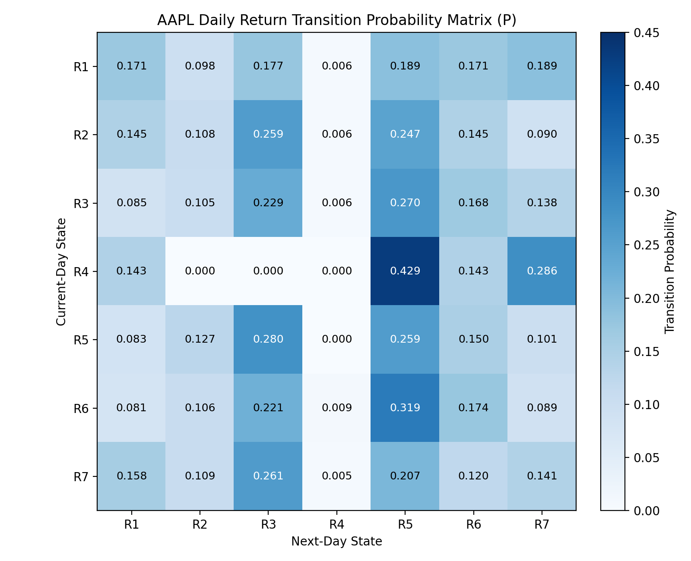
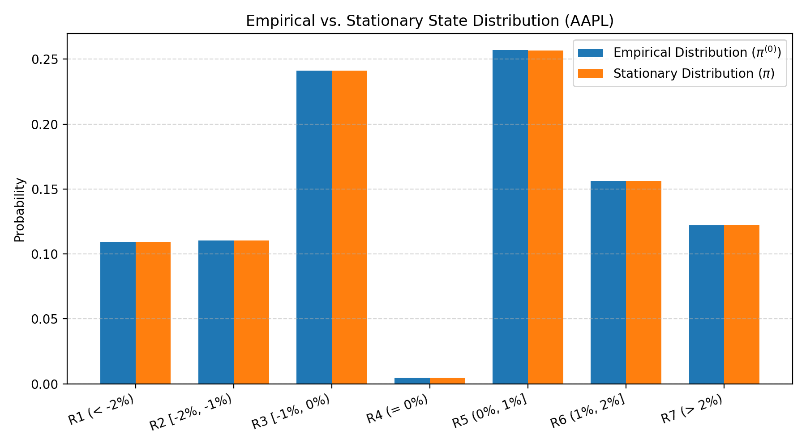
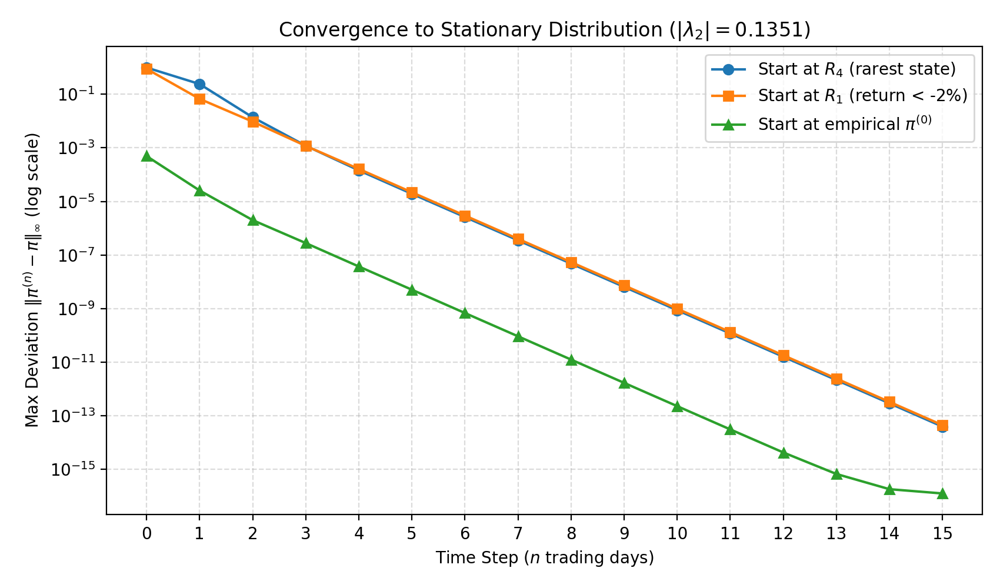
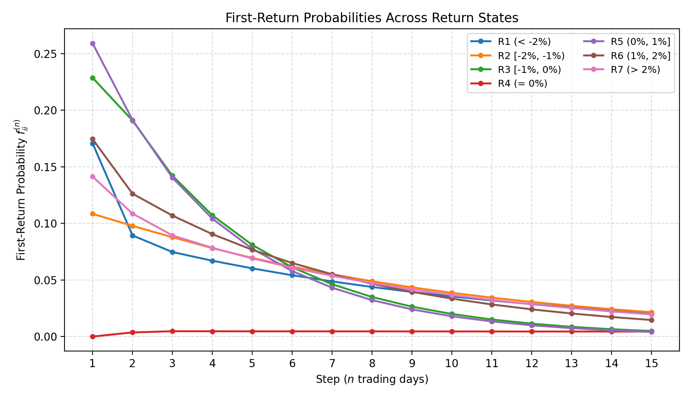

# Stock Return Modeling Using Discrete-Time Markov Chains (AAPL)

A stochastic modeling pipeline that analyzes six years of daily Apple Inc. (`AAPL`) stock returns as a 7-state discrete-time Markov chain. Built for the Stochastic Processes course at K. N. Toosi University of Technology (Spring 2025).

## Overview

Daily adjusted closing prices for **AAPL** from **2019-07-23 to 2025-07-18** (**1,506 trading days**, **1,505 consecutive transitions**) are transformed into daily percentage returns and discretized into seven regimes capturing both direction and volatility:

| State | Daily Return Range | Interpretation |
| :---: | :---: | :--- |
| `R1` | $r < -2\%$ | Sharp decline |
| `R2` | $-2\% \le r < -1\%$ | Moderate decline |
| `R3` | $-1\% \le r < 0\%$ | Mild decline |
| `R4` | $r = 0\%$ | Flat (no change) |
| `R5` | $0\% < r \le 1\%$ | Mild gain |
| `R6` | $1\% < r \le 2\%$ | Moderate gain |
| `R7` | $r > 2\%$ | Sharp gain |

### Key Structural Findings
- **Regular / Ergodic Chain:** Every entry of $P^2$ is strictly positive ($\min(P^2) = 0.0036 > 0$), proving the chain is **irreducible**, **aperiodic**, and **free of absorbing states**. Consequently, all states are positive recurrent and a unique stationary distribution $\pi$ exists.
- **Rapid Convergence:** The second-largest eigenvalue modulus is $|\lambda_2| = 0.1351$, driving rapid exponential convergence to the stationary distribution (maximum deviation $\|\pi^{(n)} - \pi\|_\infty < 10^{-4}$ within 5 trading days even from the rarest point-mass initial state `R4`).
- **Long-Run Regime Dominance:** Mild daily moves dominate AAPL's long-run behavior—`R5` ($0\%$ to $1\%$: **25.65%**) and `R3` ($-1\%$ to $0\%$: **24.12%**) together account for nearly half of all trading days, whereas exact zero-return days (`R4`: **0.47%**) occur on average once every **215 trading days**.

## Transition Probability Matrix ($P$)

| From \ To | `R1` | `R2` | `R3` | `R4` | `R5` | `R6` | `R7` |
| :---: | :---: | :---: | :---: | :---: | :---: | :---: | :---: |
| **`R1`** | 0.1707 | 0.0976 | 0.1768 | 0.0061 | 0.1890 | 0.1707 | 0.1890 |
| **`R2`** | 0.1446 | 0.1084 | 0.2590 | 0.0060 | 0.2470 | 0.1446 | 0.0904 |
| **`R3`** | 0.0854 | 0.1047 | 0.2287 | 0.0055 | 0.2700 | 0.1680 | 0.1377 |
| **`R4`** | 0.1429 | 0.0000 | 0.0000 | 0.0000 | 0.4286 | 0.1429 | 0.2857 |
| **`R5`** | 0.0829 | 0.1269 | 0.2798 | 0.0000 | 0.2591 | 0.1503 | 0.1010 |
| **`R6`** | 0.0809 | 0.1064 | 0.2213 | 0.0085 | 0.3191 | 0.1745 | 0.0894 |
| **`R7`** | 0.1576 | 0.1087 | 0.2609 | 0.0054 | 0.2065 | 0.1196 | 0.1413 |

## Stationary Distribution & Mean Recurrence Time

Solving $\pi P = \pi$ subject to $\sum_i \pi_i = 1$ yields the unique stationary distribution and expected return time $\mu_i = 1/\pi_i$:

| State | Observed Count | Empirical $\pi^{(0)}$ | Stationary $\pi$ | Mean Recurrence Time (Trading Days) |
| :---: | :---: | :---: | :---: | :---: |
| `R1` | 164 | 0.1089 | 0.1090 | 9.18 |
| `R2` | 166 | 0.1102 | 0.1103 | 9.07 |
| `R3` | 363 | 0.2410 | 0.2412 | 4.15 |
| `R4` | 7 | 0.0046 | 0.0047 | 215.00 |
| `R5` | 387 | 0.2570 | 0.2565 | 3.90 |
| `R6` | 235 | 0.1560 | 0.1561 | 6.40 |
| `R7` | 184 | 0.1222 | 0.1223 | 8.18 |

## First-Return Probabilities ($f_{ii}^{(n)}$)

Computed via the exact recurrence $f_{ii}^{(n)} = P^{(n)}_{ii} - \sum_{m=1}^{n-1} f_{ii}^{(m)} P^{(n-m)}_{ii}$ for steps $n = 1, \dots, 5$:

| State | $n=1$ | $n=2$ | $n=3$ | $n=4$ | $n=5$ |
| :---: | :---: | :---: | :---: | :---: | :---: |
| `R1` | 0.1707 | 0.0893 | 0.0747 | 0.0670 | 0.0602 |
| `R2` | 0.1084 | 0.0978 | 0.0878 | 0.0781 | 0.0695 |
| `R3` | 0.2287 | 0.1909 | 0.1421 | 0.1071 | 0.0809 |
| `R4` | 0.0000 | 0.0036 | 0.0047 | 0.0046 | 0.0046 |
| `R5` | 0.2591 | 0.1914 | 0.1403 | 0.1041 | 0.0776 |
| `R6` | 0.1745 | 0.1262 | 0.1069 | 0.0905 | 0.0767 |
| `R7` | 0.1413 | 0.1086 | 0.0894 | 0.0784 | 0.0691 |

## Visualizations

| Transition Probability Heatmap | Empirical vs. Stationary Distribution |
| :---: | :---: |
|  |  |

| Convergence to Stationary Distribution | First-Return Probabilities |
| :---: | :---: |
|  |  |

## Usage

### 1. Install Dependencies
```bash
pip install -r requirements.txt
```

### 2. Run Analysis (Reproducible Offline Mode)
The discretized 6-year dataset (`data/AAPL_states.csv`) is included so all tables and plots can be reproduced directly without an API key:

```bash
python markov_analysis.py --csv data/AAPL_states.csv --output outputs
```

### 3. (Optional) Re-fetch Historical Data via API
To download fresh price data from Financial Modeling Prep, set your personal API key via the `FMP_API_KEY` environment variable:

```bash
# Linux / macOS
export FMP_API_KEY="your_api_key_here"

# Windows PowerShell
$env:FMP_API_KEY="your_api_key_here"

python fetch_data.py --symbol AAPL --start 2019-07-23 --end 2025-07-18 --output data/AAPL_states.csv
```

## Model Limitations
- **First-Order Memoryless Assumption:** Assumes next-day return states depend solely on the current day, ignoring multi-day momentum or volatility clustering.
- **Time-Homogeneous Transitions:** Uses a stationary transition matrix $P$ across all market regimes (e.g., high-volatility drawdowns vs. bull markets).
- **Exogenous Factors & Discretization:** Excludes trading volume, macroeconomic releases, and earnings events, and compresses continuous returns into seven discrete bins.

## Author
- **Adel Nourbakhsh**